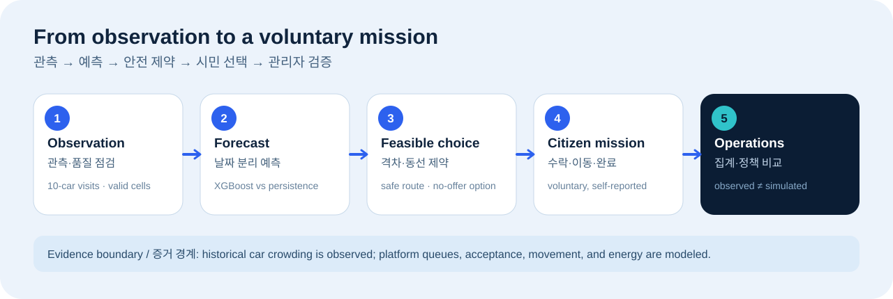
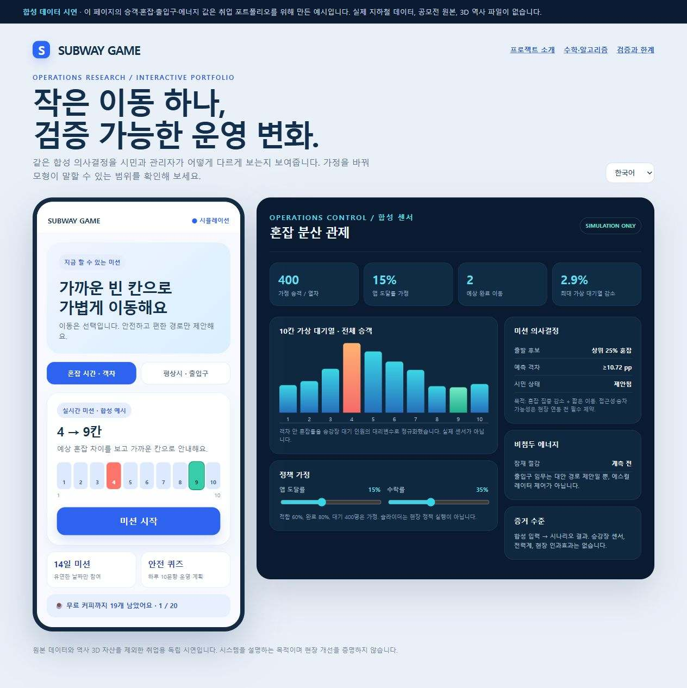
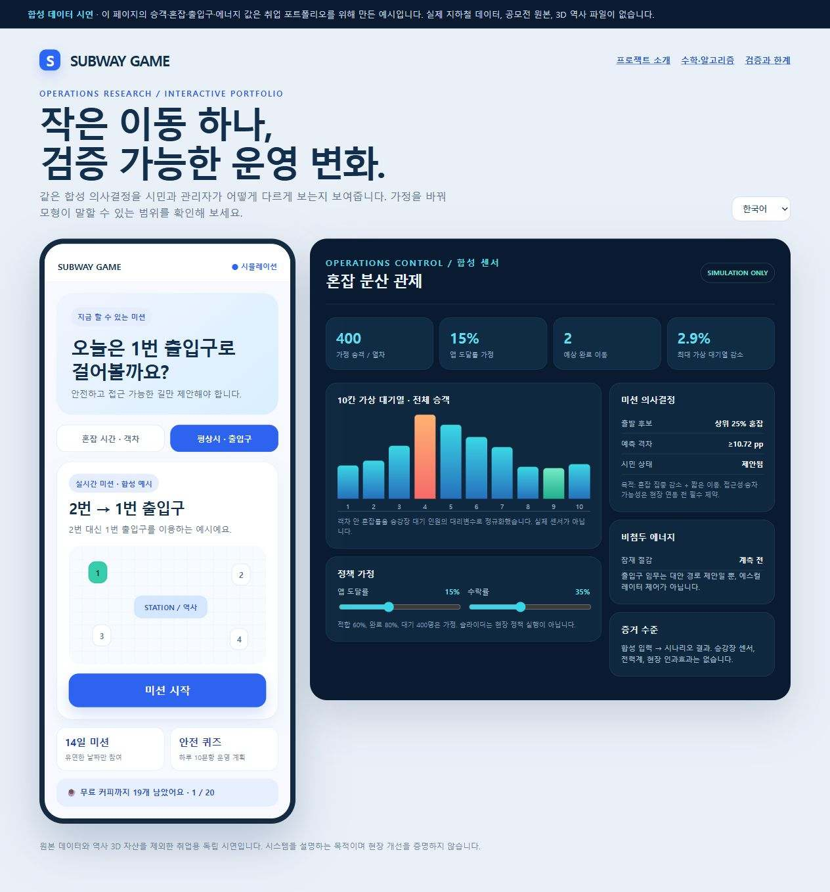
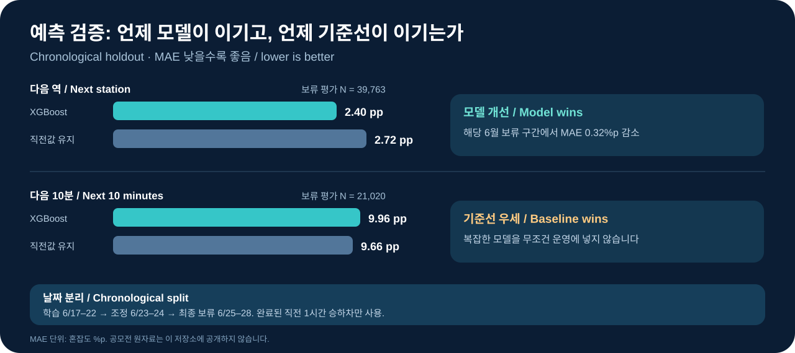
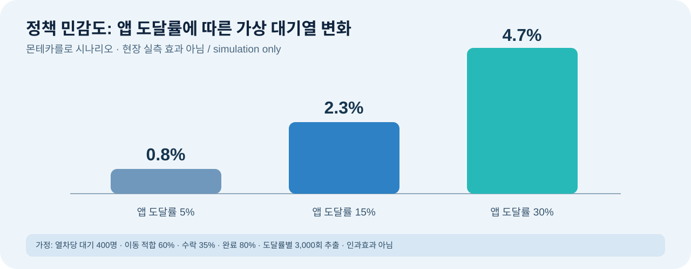

# SUBWAY GAME — 도시철도 혼잡 분산 최적화

**산업공학 · 운영연구(OR) · 데이터 분석 · 사용자 참여형 운영**

[English README](README.md) · [합성 데이터 시연](https://doyunsin883-debug.github.io/subway-game-crowding-optimization/) · [수학·알고리즘](docs/METHODS.md) · [시스템 구성](docs/ARCHITECTURE.md) · [검증과 한계](docs/EVIDENCE.md)

> **2026 서울교통공사 / 한국국토교통데이터진흥협회(KALDA) 「지하철 혼잡도 및 안전시설 데이터 활용 서비스 발굴 공모전」 출품을 위해 개발한 프로젝트**의 취업 포트폴리오 공개판입니다. 이 저장소의 인터랙티브 시연은 합성 수치와 자체 제작 도식만 사용합니다. 공모전 제공 원본 데이터, 역사 GLB/SHP 모델, 상세 재생 파일, 인증정보, 참가서류는 넣지 않았습니다.

## 화면과 구조 한눈에 보기 / See the demo



| 혼잡 시간: 객차 이동 미션 / Peak | 평상시: 출입구 미션 / Off peak |
|---|---|
|  |  |

두 이미지는 **공개용 합성 시연**을 캡처한 것입니다. 실제 역사 3D 모델이나 승객 이동 로그가 아닙니다. **[클릭해서 웹 시연하기 / Interactive demo →](https://doyunsin883-debug.github.io/subway-game-crowding-optimization/)**

## 어떻게 예측했는가 / Forecasting method

1. **자료 정리:** 제공된 CSV 69개에서 결측·음수 셀·중복을 확인하고 10칸 값이 모두 유효한 열차 방문 9,909건을 분리했습니다.
2. **미래 정보 차단:** 현재 객차, 인접 객차, 역·시간, *완료된 직전 1시간* 승하차만 입력에 넣었습니다. 요금유형을 개인의 나이·성별로 해석하지 않았습니다.
3. **날짜 분리:** 2026년 6월 17–22일 학습, 23–24일 조정, 25–28일 최종 보류 평가로 구성했습니다.
4. **단순 기준선과 비교:** XGBoost 회귀와 현재 객차 혼잡도를 그대로 쓰는 기준선을 비교했습니다. 다음 10분 과제는 기준선이 더 정확했습니다.
5. **미션 발행 제한:** 다음 역 모델의 절대오차 90백분위인 5.36%p의 두 배, 즉 예측 격차 10.72%p 이상을 요구하고 보행·안전 제약을 확인합니다. 이는 운영상 보수적 기준이며 정확도 보증은 아닙니다.



### 핵심 수식 / Core equations

```text
MAE = (1/n) Σ |ŷ_i − y_i|                           예측 오차
gap(i,j) = ŷ_출발칸(i) − ŷ_목표칸(j) ≥ 10.72 %p     미션 발행 기준
D_max = (max_j q_이전,j − max_j q_이후,j) / max_j q_이전,j
HHI(q) = Σ_j (q_j / N)^2                            전체 대기열 밀집도
예상 완료 ≈ 전체 승객 × 앱 도달률 × 자격률 × 수락률 × 완료율
```

위 대기열 수식은 **가상 승강장 인원**에 적용됩니다. 객차 내부 혼잡도는 승차 대기 구역의 대리 지표일 뿐, 실제 승강장 대기열은 측정하지 못했습니다. 전역 최적화 목적함수와 제약은 [수학·알고리즘 상세](docs/METHODS.md)에 있습니다.



## 1분 요약

객차 혼잡도를 보여주기만 해서는 시민의 대기 위치가 바뀌지 않습니다. 이 프로젝트는 **누구에게 어떤 이동을 제안해야 수락 가능성과 전체 혼잡 개선을 함께 높일 수 있는가**, 그리고 **운영자가 그 효과를 어떻게 검증할 것인가**를 다룹니다.

전체 프로토타입은 시민용 모바일 웹과 관리자용 관제 웹으로 나뉩니다. 혼잡 시간에는 가까운 저혼잡 승차 구역을 제안하고, 평상시에는 안전한 대체 출입구를 제안합니다. 14일 미션은 시간·역 선택에 유연성이 있는 시민의 수요를 분산하기 위한 기능입니다. 안전 퀴즈와 보상은 재방문을 유도하는 참여 장치입니다.

```text
과거 관측 → 품질 점검 → 기준선·예측
→ 안전 제약을 통과한 미션 → 시민 수락·거절·완료
→ 관리자 집계 → 정책 비교 → 운영 조건 수정
```

**현재 서비스는 시뮬레이션 프로토타입입니다.** 실시간 서울교통공사 관제망이나 현장 센서에 연결된 실증 서비스가 아닙니다. 기존 전체 시연에 사용한 공모전 제공 공간 파일과 상세 재생값은 이 공개 저장소에 포함하지 않았습니다.

## 구현한 것과 앞으로 검증할 것

| 영역 | 전체 프로토타입에서 구현 | 증거의 범위 |
|---|---|---|
| 시민 화면 | 모바일 미션, 이동 진행률, 퀴즈·보상·날씨·열차 안내, 한/영/일 | 도착은 시연용 자기보고 |
| 관리자 화면 | 관측 날짜별 재생, 10칸 혼잡, 정책 조작, 400명 합성 반응, 역사 3D | 과거 관측과 합성 센서를 구분 표시 |
| 데이터 처리 | 품질 집계, 10칸 편성 재구성, 공개 승하차 통계 결합 | 원자료는 공개 저장소에서 제외 |
| 예측 | 다음 역/다음 10분 XGBoost, 날짜 분리 평가 | 10분 예측 MAE는 단순 기준선보다 열세 |
| 미션 배정 | 혼잡 상위 구역에서 예측 차이·이동 거리로 후보 순위화 | 개인 수락률 학습과 전역 최적화는 제안 단계 |
| 정책 평가 | 400명 합성 코호트와 몬테카를로 반사실 분석 | 현장 인과효과가 아님 |
| 에너지 | 출입구 수요·에스컬레이터 대기 전환 시나리오 | 전력 실측값 없음 |

## 산업공학 관점의 핵심 질문

1. **데이터 분석:** 결측과 음수가 있는 자료로 역 × 시간 × 칸 기준선을 어떻게 구성하는가?
2. **OR:** 최대 대기열·집중도·보행 부담·접근성·수락 가능성을 어떻게 함께 최적화하는가?
3. **실험 설계:** 앱 비사용자와 혼잡 전이를 포함했을 때 실제 정책 효과는 얼마인가?
4. **경제성공학:** 쿠폰·운영·연동 비용과 검증된 편익이 어떤 조건에서 균형을 이루는가?

## 수치와 해석 범위

- 제공된 2026년 6월 자료 **69개 CSV, 390,865행**을 점검하고 **완전한 10칸 열차 방문 9,909건**을 재구성했습니다. 이는 승강장 대기 인원 센서가 아니라 객차 혼잡 관측입니다.
- 날짜 분리 평가(학습 6/17–24, 보류 6/25–28)에서 다음 역 혼잡 MAE는 XGBoost **2.40%p**, 직전값 유지 **2.72%p**였습니다. 다음 10분 혼잡은 각각 **9.96%p**, **9.66%p**로 단순 기준선이 더 좋았습니다.
- 400명 **가정** 대기열에 대한 기계적 몬테카를로 시나리오에서는 앱 도달률 5/15/30%일 때 최대 가상 대기열의 평균 감소가 약 **0.8/2.3/4.7%**였습니다. **현장 개선율이 아닙니다.** 가정과 계산은 [검증 문서](docs/EVIDENCE.md)에 있습니다.

## 살펴보는 순서

1. [시스템 구성·마인드맵](docs/ARCHITECTURE.md): 시민과 관리자 인터페이스, 데이터 흐름, 관측/시뮬레이션 경계
2. [수학·알고리즘](docs/METHODS.md): 품질 점검, 기준선, 예측 평가, 미션 배정, 시뮬레이션, 에너지·경제성 수식
3. [검증과 한계](docs/EVIDENCE.md): 무엇을 실제 관측했고 무엇을 가정했는지, 현장 실험 계획
4. [운영계획](docs/OPERATIONS.md): 하루 10문항 안전 퀴즈, 14일 미션, 보상·제휴·안전 중단 기준
5. [데이터·저작권 경계](docs/DATA_GOVERNANCE.md): 원본 파일을 제외한 이유
6. [합성 데이터 시연 안내](docs/DEMO.md) 및 [실행 코드](src/synthetic_policy.py)

```bash
python src/synthetic_policy.py
```

추가 패키지나 원본 데이터 없이 실행됩니다. 브라우저에서는 `site/index.html` 또는 위의 GitHub Pages 시연을 열면 됩니다. **공개용 시연 값은 합성이며, 위 실측 기반 요약 수치와 같지 않습니다.**

## 출처와 권리

공모전 주최는 서울교통공사, 주관은 KALDA입니다. 공모전 제공 데이터와 역사 모델의 권리는 각 권리자에게 있습니다. 이 저장소는 해당 원본을 재배포하거나 그 복제 권한을 부여하지 않습니다. 별도로 사용한 [서울교통공사 승하차 공개자료](https://www.data.go.kr/data/15099330/fileData.do)는 공공데이터포털에 이용허락범위 “제한 없음”으로 표시되어 있지만, 원본 CSV 역시 이 저장소에 복제하지 않았습니다. 주최기관의 공식 승인·후원을 의미하지 않습니다.
