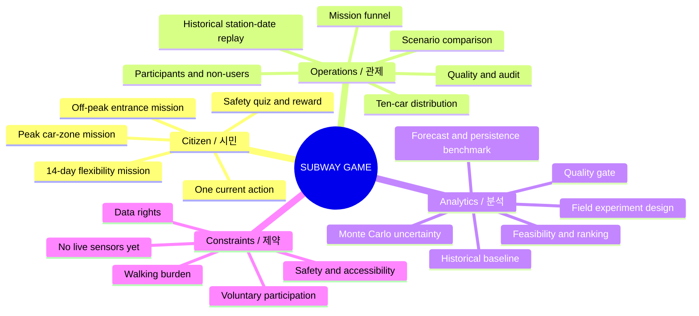
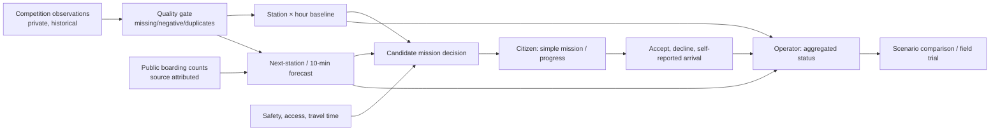

# System architecture / 시스템 구성

## System mind map / 전체 마인드맵

## Data-to-decision architecture / 데이터-의사결정 구조

**한국어:** 시민 화면은 현재의 이동 지시와 보상 진도만 강조합니다. 관리자는 관측 일시, 열차별 10칸 분포, 과거 기준선 편차, 참여/비참여, 시뮬레이션 정책 효과를 봅니다. 원자료와 가정값의 레이블을 분리합니다.

**English:** The citizen sees the next feasible action and reward progress. The operator sees observation time, ten-car distribution, baseline deviation, both users and non-users, and modeled policy effects. Historical observations, model outputs, and synthetic response logs are separately labeled.

## Prototype boundaries / 구현 경계

| Label in design | Meaning / 의미 | What it is not / 아닌 것 |
|---|---|---|
| HISTORICAL_OBSERVATION | Supplied June car crowding, selected by station/date | Live platform sensor |
| PUBLIC_AGGREGATE | Published station-hour boarding counts | Individual trajectory or age/sex |
| ML_PREDICTION | Precomputed model output from earlier observations | Verified live occupancy |
| SYNTHETIC_COHORT | Deterministic simulated 400-person response | Measured app uptake |
| ASSUMED_POWER | Escalator/entrance what-if calculation | Metered kWh saving |
| SELF_REPORTED | Citizen taps arrival in prototype | Independently verified location |

## Separate interaction models / 분리된 인터페이스

### Citizen / 시민

1. Home: weather, train notice, reward progress, one prominent mission button.
2. Peak mission: a ten-car zone visualization; accept → moving → arrival → clear.
3. Off-peak mission: schematic entrance map with entrance numbers; do not expose operator-only statistics.
4. 14-day mission, quiz, reward details are secondary screens.

### Operator / 관리자

1. Station/date controls and historical replay time.
2. Car occupancy, baseline deviation, next train context, synthetic mission funnel.
3. Policy scenario settings (reach, acceptance, completion); assumptions always visible.
4. Data-quality and audit views.
5. Energy scenarios remain proposals until power meters and safety approval are integrated.

## Full prototype stack / 전체 프로토타입 기술

- Front end: semantic HTML, CSS, vanilla JavaScript; Three.js for the supplied station GLB in the **non-public full prototype**.
- Operations API: Netlify Functions and Netlify Blobs share simulated mission state between citizen and admin deployments.
- Analysis: Python, NumPy, XGBoost; forecasts are precomputed so the browser does not train a model.
- Deployment: two Netlify applications for different user roles. This portfolio-safe GitHub Pages example is separate and uses no Netlify API.

**Implementation caveat / 구현 주의:** A production deployment would need authenticated operator roles, real event timestamps, data contracts, stream processing, location/arrival verification with consent, and incident stop controls. The current prototype does not claim those connections.
